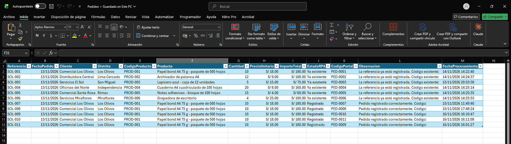
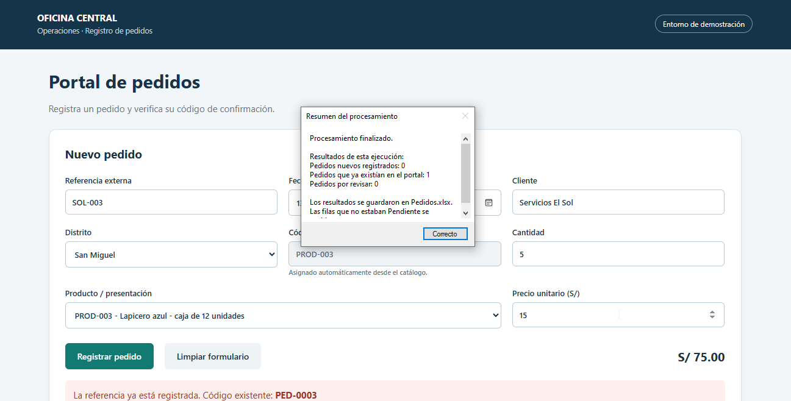
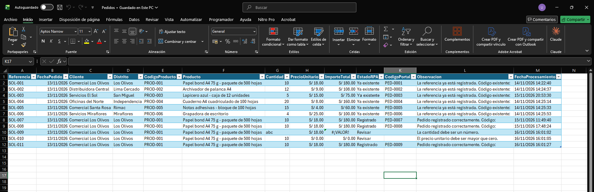
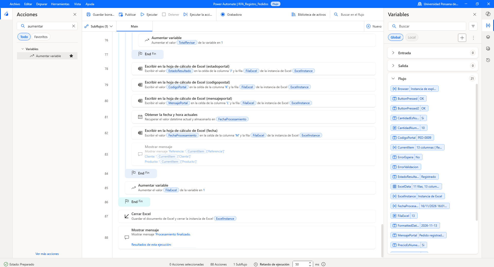
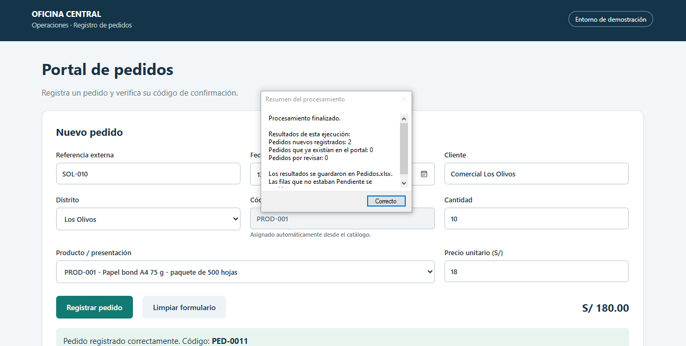
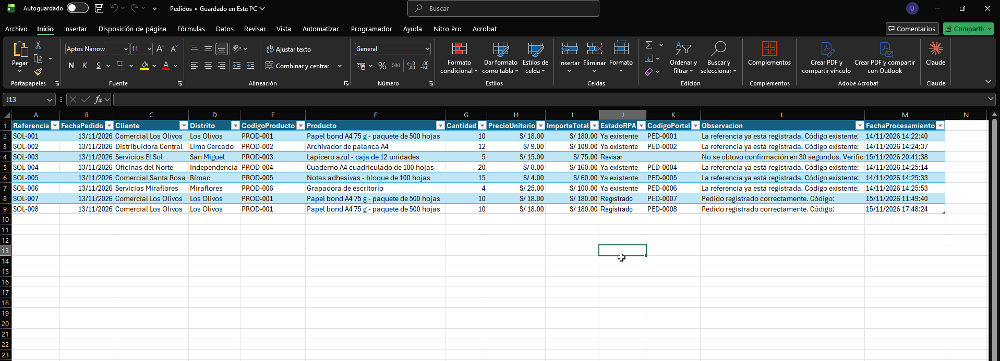

# Order Processing RPA
### Automatización del registro de pedidos con Power Automate Desktop

Automatización que procesa pedidos desde Microsoft Excel y los registra en un portal web de demostración. El flujo valida datos, identifica referencias ya existentes y guarda el resultado de cada pedido en el archivo de origen.

Desarrollé este proyecto para aplicar RPA a una tarea operativa habitual: trasladar información de una hoja de cálculo a un sistema web, manteniendo un registro de los pedidos procesados y de los casos que necesitan revisión.

**Tecnologías:** Power Automate Desktop · Microsoft Excel · Microsoft Edge

## Contexto y objetivo

El registro manual de pedidos implica copiar información entre aplicaciones, comprobar los datos ingresados y verificar que cada operación se haya completado. Cuando existen registros repetidos o datos incorrectos, también es necesario identificar qué ocurrió antes de continuar.

Este proyecto automatiza ese recorrido y centraliza los resultados en Excel. Su objetivo es reducir la intervención manual en el registro y facilitar el seguimiento de cada pedido mediante su estado, código de confirmación, observación y fecha de procesamiento.

> Proyecto de portafolio desarrollado sobre un portal de demostración. Las evidencias corresponden a pruebas funcionales; no representan métricas de una operación productiva.

## Funcionalidades

- **Procesamiento selectivo:** trabaja con las filas cuyo estado es `Pendiente`.
- **Validación de datos:** identifica inconsistencias, como cantidades no numéricas y precios unitarios no válidos.
- **Registro web:** completa el formulario del portal con la información del pedido.
- **Interpretación de resultados:** distingue entre un registro exitoso, una referencia existente y un caso que requiere revisión.
- **Control del tiempo de espera:** registra una observación cuando no obtiene confirmación dentro del plazo previsto.
- **Trazabilidad en Excel:** actualiza el estado, código del portal, observación y fecha de procesamiento.
- **Resumen de ejecución:** muestra el total de pedidos nuevos, existentes y por revisar.

## Funcionamiento

1. Abre el archivo `Pedidos.xlsx` y lee los registros.
2. Recorre las filas y selecciona los pedidos con estado `Pendiente`.
3. Valida los datos contemplados en el flujo.
4. Completa y envía el formulario web cuando corresponde.
5. Interpreta la respuesta del portal o identifica la falta de confirmación.
6. Escribe el resultado de cada pedido en Excel.
7. Guarda el archivo y muestra el resumen del procesamiento.

### Estados del pedido

| Estado | Significado |
| --- | --- |
| `Pendiente` | Pedido disponible para ser procesado. |
| `Registrado` | El portal confirmó el registro del pedido. |
| `Ya existente` | El portal indicó que la referencia ya estaba registrada. |
| `Revisar` | El pedido requiere atención por una validación, falta de confirmación u otra incidencia contemplada en el flujo. |

La identificación de referencias existentes se basa en la respuesta del portal. Esto permite distinguirlas de los pedidos registrados durante la ejecución.

## Estructura del repositorio

| Ruta | Contenido |
| --- | --- |
| `README.md` | Descripción del proyecto, funcionamiento y evidencias. |
| `Pedidos.xlsx` | Archivo de pedidos y seguimiento de resultados. |
| `Flujo/` | Archivo de texto con las acciones del flujo de Power Automate Desktop. |
| `Evidencias/` | Capturas de los escenarios de prueba. |
| `Respaldo/` | Archivos de respaldo del proyecto. |

### Estructura de los datos

El archivo Excel reúne los datos del pedido y los campos de seguimiento:

| Grupo | Columnas |
| --- | --- |
| Identificación | `Referencia`, `FechaPedido` |
| Cliente | `Cliente`, `Distrito` |
| Producto | `CodigoProducto`, `Producto` |
| Datos económicos | `Cantidad`, `PrecioUnitario`, `ImporteTotal` |
| Seguimiento | `EstadoRPA`, `CodigoPortal`, `Observacion`, `FechaProcesamiento` |

Los campos de seguimiento permiten consultar qué ocurrió con cada pedido sin depender únicamente de los mensajes mostrados durante la ejecución.

## Evidencias de funcionamiento

### Registro exitoso

El portal confirma la operación y devuelve un código de pedido. Al finalizar, el flujo muestra el resumen de la ejecución.

### Referencia ya existente

Cuando la referencia ya está registrada, el flujo identifica la respuesta del portal y clasifica el pedido como `Ya existente`.

### Validación de datos

Los pedidos con inconsistencias quedan en estado `Revisar`, acompañados de una observación que facilita su corrección. Las pruebas incluyen una cantidad no numérica y un precio unitario igual a cero.

### Resumen del procesamiento

La ejecución presenta un consolidado de pedidos registrados, referencias existentes y casos pendientes de revisión.

### Corrección y reprocesamiento

Después de corregir los datos y devolver los pedidos al estado `Pendiente`, es posible ejecutar nuevamente el flujo y actualizar sus resultados.

### Tiempo de espera agotado

Si no se obtiene confirmación dentro de 30 segundos, el pedido queda marcado para revisión con la observación correspondiente.

> La falta de confirmación no demuestra que el pedido haya sido rechazado. Antes de reprocesarlo, corresponde verificar su situación en el portal.

## Preparación y ejecución

### Requisitos

- Equipo Windows con Power Automate Desktop.
- Microsoft Excel de escritorio.
- Microsoft Edge configurado para la automatización web.
- Acceso al portal de demostración utilizado por el flujo.
- Copia local de los archivos del repositorio.

### Configuración

1. Descarga el repositorio y ubica `Pedidos.xlsx` en tu equipo.
2. Revisa el archivo de acciones disponible en `Flujo/` para preparar el flujo en Power Automate Desktop.
3. Ajusta la ruta del archivo Excel y la dirección del portal según tu entorno.
4. Comprueba los elementos web utilizados por la automatización.
5. Conserva los nombres y el orden de las columnas del archivo de pedidos.
6. Coloca el estado `Pendiente` en las filas que deseas procesar.
7. Ejecuta el flujo y revisa el resumen y los resultados guardados en Excel.

**Para repetir las pruebas:** el archivo mostrado en las evidencias contiene pedidos ya procesados. Revisa sus estados antes de ejecutar el flujo; las filas que no estén en `Pendiente` se omitirán.

## Alcance y consideraciones

- La automatización depende de la estructura del formulario y de los mensajes del portal utilizado.
- Un cambio en los elementos web puede requerir actualizar los selectores del flujo.
- El archivo de acciones debe configurarse y verificarse en el entorno de destino; no constituye por sí solo una instalación lista para ejecutar.
- Los casos marcados como `Revisar` requieren comprobar la observación y corregir o verificar el pedido antes de reprocesarlo.
- Las capturas documentan pruebas funcionales. No se han cuantificado ahorros de tiempo ni mejoras porcentuales de productividad.

## Aprendizajes del proyecto

El desarrollo me permitió trabajar la integración entre Excel y un formulario web, la validación previa al registro y el tratamiento de distintas respuestas del sistema.

Además de automatizar el ingreso de datos, el proyecto pone énfasis en dejar información útil para el seguimiento: qué pedidos se registraron, cuáles ya existían y cuáles necesitan intervención.

## Posibles mejoras

- Incorporar un historial de ejecuciones independiente del archivo de pedidos.
- Ampliar las validaciones de campos obligatorios y formatos.
- Centralizar rutas, tiempos de espera y otros parámetros de configuración.
- Añadir una consulta de confirmación antes de reintentar operaciones sin respuesta.
- Medir tiempos de ejecución para comparar el proceso manual con el automatizado.

## Autor

**Juan Manuel Tafur Recuay**  
[Perfil de GitHub](https://github.com/JuanTF)
